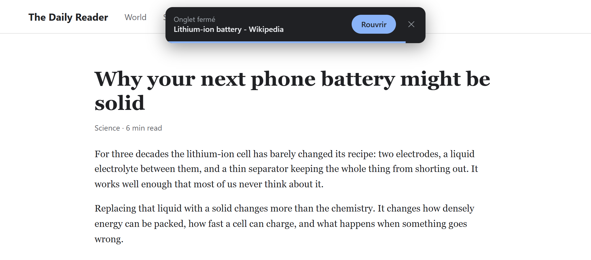
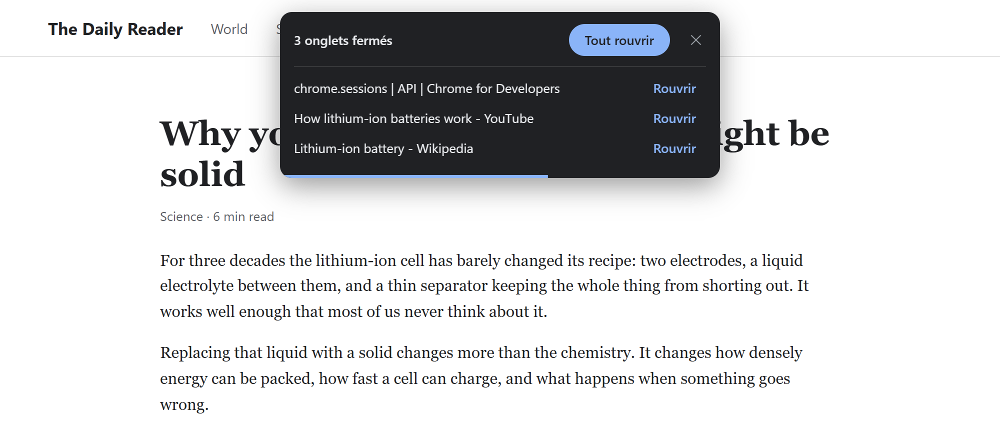
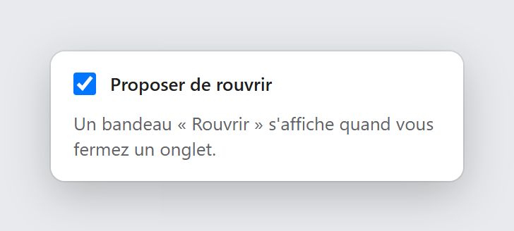

# Confirmer la fermeture d'onglet

A Chrome extension that catches accidental tab closes. The moment you close a tab, a banner offers to bring it back.

## What it does

- **One click to undo.** When a tab closes, a banner appears at the top of the page you land on: "Onglet fermé · Rouvrir". Click **Rouvrir** and the tab returns to where it was, with its back and forward history.
- **Several tabs, one banner.** Close a few tabs in a row and each one gets its own line with its own **Rouvrir** button, newest first, plus **Tout rouvrir** to bring them all back. Tabs closed in a single gesture ("Close other tabs") share one line.
- **Follows you.** If you switch tabs before answering, the banner moves to the tab you are on with the time it has left.
- **Gets out of the way.** The banner disappears on its own 7 seconds after the last tab you closed, and the countdown pauses while your mouse is over it.
- **Only when it makes sense.** Nothing is offered when you close a whole window or an internal page such as a new tab.
- **Works on protected pages too.** Where Chrome does not allow a banner (new tab, `chrome://` pages), the same banner opens in a small window instead.
- **Easy to pause.** The toolbar button turns the extension on and off. A red "OFF" badge shows when it is paused.

The interface is in French.

## Install

The extension is not on the Chrome Web Store, so it is loaded by hand:

1. Download this repository (**Code**, then **Download ZIP**) and unzip it, or clone it.
2. Open `chrome://extensions` and turn on **Developer mode**.
3. Click **Load unpacked** and choose the folder.

## Why not a real "are you sure?" prompt

Chrome does not let an extension hold a tab open while it closes. So this extension does the reverse: it lets the tab close, then offers to reopen it straight away.

## Privacy

Everything stays on your computer. The extension has no server and makes no network requests.

| Permission | Why it is needed |
| --- | --- |
| `sessions` | Find the tab that was just closed and restore it |
| `tabs` | Know when a tab closes and which tab is active |
| `scripting` and access to all sites | Show the banner on whatever page you are on |
| `storage` | Remember whether the extension is on or paused |
| `favicon` | Show the closed tab's icon in the banner |

## License

[MIT](LICENSE) © 2026 Yanis Arris
